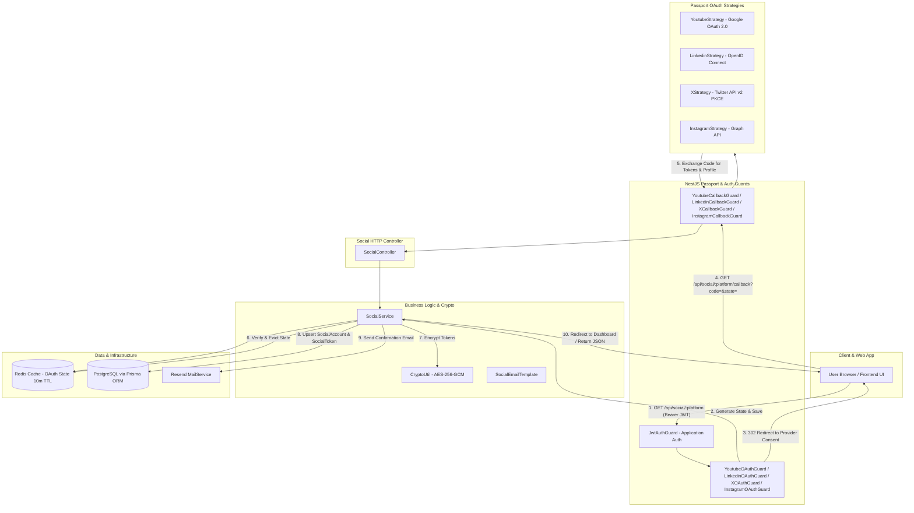
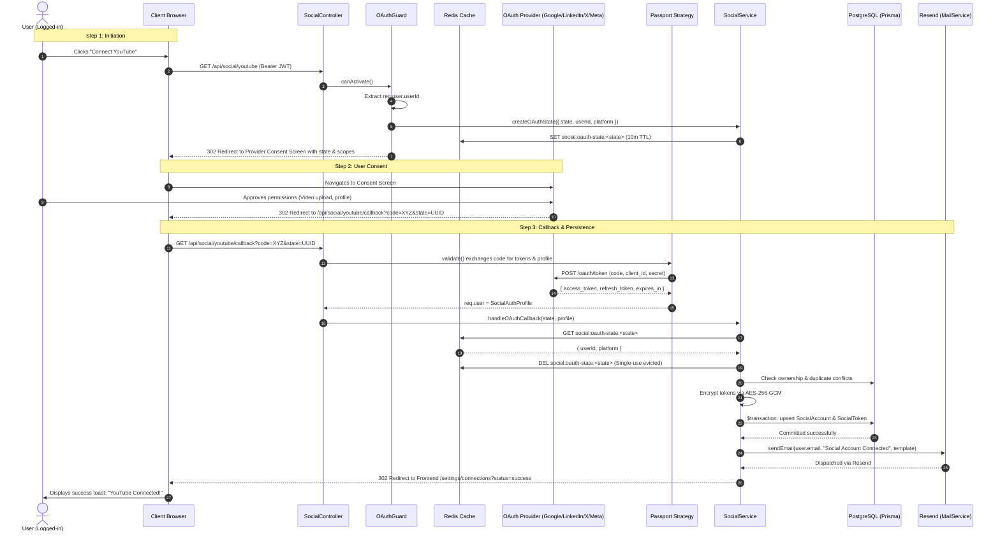
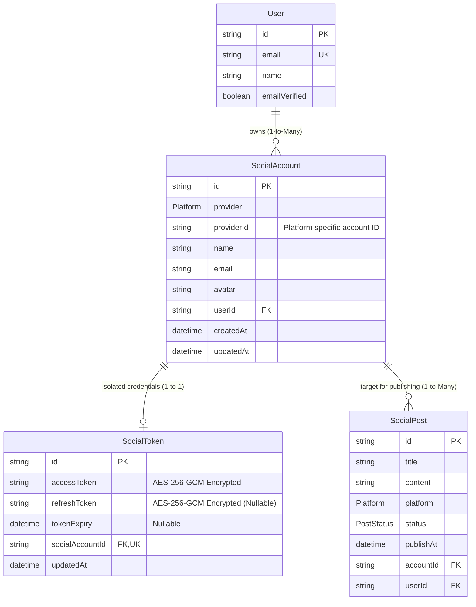

# Aayeshol Social Media OAuth Integration - Architecture & Technical Reference

## 1. Overview & Architectural Objective

**Aayeshol v2** ek advanced, AI-powered social media management aur automated scheduling SaaS platform hai.

Is **Social OAuth Integration** ka single and exclusive purpose hai:

> **Authenticated Aayeshol users ko unke third-party social media accounts (YouTube, LinkedIn, X/Twitter, Instagram) connect karne ki suvidha dena, taaki future me background workers un accounts par automated posts aur media publish kar sakein.**

### Critical Architectural Principle:

- **This is NOT Application Authentication / Login:** Is module ka use Aayeshol me login ya account registration ke liye **kabhi nahi** hota. Aayeshol ka primary auth system (`apps/api/src/auth`) alag hai aur 2-Step OTP flow par chalta hai.
- **Account Linking Only:** User pehle Aayeshol me authenticate hota hai, aur phir dashboard se apne external social accounts link karta hai.
- **Encrypted Token Isolation:** Saare OAuth access aur refresh tokens AES-256-GCM se encrypt hokar isolated `SocialToken` model me persist hote hain aur background workers dwara post publishing ke time hi decrypt kiye jaate hain.

---

## 2. System Architecture & Component Diagram

Neeche diya gaya Mermaid diagram dikhata hai ki `SocialModule` ke sabhi components ek doosre ke saath, Prisma database, Redis cache, aur Resend mail service se kase connect hote hain:



---

## 3. Directory Structure & Component Breakdown

Poora social integration `apps/api/src/social/` ke andar modular architecture follow karta hai:

```
apps/api/src/social/
├── constants/
│   └── social.constants.ts       # Redis state keys, 10m TTL, scopes definition
├── doc/
│   ├── social-api-test-doc.md    # API testing, Postman, headers & status codes guide
│   └── social-doc.md             # Architecture, design decisions & workflow guide
├── dto/
│   └── social.dto.ts             # OAuth callback query validation & params DTOs
├── guards/
│   ├── youtube-oauth.guard.ts    # YouTube initiate guard & callback guard
│   ├── linkedin-oauth.guard.ts   # LinkedIn initiate guard & callback guard
│   ├── x-oauth.guard.ts          # X initiate guard & callback guard
│   └── instagram-oauth.guard.ts  # Instagram initiate guard & callback guard
├── strategies/
│   ├── youtube.strategy.ts       # Google OAuth 2.0 strategy for YouTube
│   ├── linkedin.strategy.ts      # LinkedIn OAuth 2.0 strategy
│   ├── x.strategy.ts             # Twitter API v2 OAuth 2.0 PKCE strategy
│   └── instagram.strategy.ts     # Instagram Graph API strategy
├── templates/
│   └── social-email.template.ts  # Dark-themed HTML email template for Resend
├── types/
│   └── social.types.ts           # OAuthStateData, SocialAuthProfile, contracts
├── utils/
│   └── crypto.util.ts            # AES-256-GCM symmetric token encryption
├── social.controller.ts          # REST endpoints for initiation, callbacks, listing & deleting
├── social.service.ts             # Core business logic, token encryption, state & email orchestration
└── social.module.ts              # NestJS module declaration wiring all dependencies
```

---

## 4. Deep-Dive: File-by-File Explanation

### 1. `social.constants.ts`

- **`KEY_OAUTH_STATE(state: string)`**: Redis key template (`social:oauth-state:${state}`).
- **`OAUTH_STATE_TTL_SECONDS`**: `600` seconds (10 minutes). User ko external login screen par consent approve karne ke liye ample time deta hai.
- **`OAUTH_SCOPES`**: Platform-specific comprehensive scopes for post reading, publishing, deleting, and Google Drive media selection:
  - **YouTube & Google Drive (Google OAuth 2.0):**
    - `youtube`, `youtube.force-ssl`: Full video & channel management (read, write, update, delete videos).
    - `youtube.upload`, `youtube.readonly`: Direct video uploading and channel metrics.
    - `drive.readonly`, `drive.file`: Read, fetch, select, and stream media files from user's Google Drive for automated post attachments.
    - `userinfo.profile`, `userinfo.email`: Channel identity & email.
  - **LinkedIn:** `openid`, `profile`, `email`, `w_member_social` (Create, edit, and delete member posts), `r_member_social` (Read member posts and analytics).
  - **X (Twitter):** `tweet.read`, `tweet.write` (Create and delete tweets), `users.read`, `media.write` (Upload media/images/videos for tweets), `offline.access` (Persistent background refresh tokens).
  - **Instagram:** `instagram_basic`, `instagram_content_publish` (Create & publish posts, reels, carousels), `instagram_manage_comments` (Read & delete comments), `instagram_manage_insights`, `pages_show_list`, `pages_read_engagement`, `user_profile`, `user_media`.

### 2. `crypto.util.ts` (AES-256-GCM Symmetric Encryption)

Database schema me clearly defined hai:
`SocialToken.accessToken` (`AES-encrypted OAuth access token`) aur `SocialToken.refreshToken` (`AES-encrypted OAuth refresh token`).

- **`encryptToken(plaintext, key)`**:
  1. 12-byte random Initialization Vector (`iv`) generate karta hai.
  2. `crypto.createCipheriv('aes-256-gcm', key, iv)` use karke encrypt karta hai.
  3. 16-byte Authentication Tag (`authTag`) extract karta hai (tamper-proofing ke liye).
  4. Format: `<iv_hex>:<authTag_hex>:<ciphertext_hex>`.
- **`decryptToken(encryptedData, key)`**:
  Payload split karke Auth Tag verify karta hai. Agar ciphertext kisi ne modify kiya ho to exception throw karta hai.
- **Key Derivation**: Key `ENCRYPTION_KEY` env variable se li jaati hai, ya fallback ke roop me `JWT_ACCESS_SECRET` ka SHA-256 hash derive kiya jata hai (32 bytes).

### 3. `social.types.ts`

- **`OAuthStateData`**: Redis me store hone wala transaction object:
  ```typescript
  {
    state: string;       // UUIDv4
    userId: string;      // Aayeshol User ID
    platform: Platform;  // YOUTUBE | LINKEDIN | X_TWITTER | INSTAGRAM
    sessionId?: string;  // Active telemetry session
    createdAt: number;   // Epoch timestamp
  }
  ```
- **`SocialAuthProfile`**: Passport Strategy dwara return hone wala standard object:
  Includes `provider`, `providerId`, `name`, `email`, `avatar`, `accessToken`, `refreshToken`, `tokenExpiry`, `grantedScopes`.
- **`ConnectedAccountResponse`**: Frontend ko return hone wala safe object (tokens completely excluded).

### 4. Passport Strategies: Design Decisions & Real-World Compatibility

#### A. YouTube Strategy (`youtube.strategy.ts`)

- **Package:** `passport-google-oauth20`
- **Why Google OAuth 2.0:** YouTube Google ecosystem ka part hai. Google Cloud Console me YouTube Data API v3 enable hoti hai.
- **Offline Refresh Token:** Google sirf tab refresh token deta hai jab:
  1. `accessType: 'offline'` set ho.
  2. `prompt: 'consent'` explicitly pass kiya gaya ho.
- Strategy Google profile se `id`, `displayName`, `emails`, aur `photos` extract karke `SocialAuthProfile` banati hai.

#### B. LinkedIn Strategy (`linkedin.strategy.ts`)

- **Package:** `passport-linkedin-oauth2`
- **Modern LinkedIn Permissions:** LinkedIn v2 API OpenID Connect standard follow karta hai. Scopes `openid profile email` user identity provide karte hain aur `w_member_social` UGC/Post creation permission deta hai.
- Access token lifespan typically 60 days hota hai.

#### C. X / Twitter Strategy (`x.strategy.ts`) - **Important Compatibility Decision**

- **Legacy Issue with `passport-twitter`:**
  `passport-twitter` package **OAuth 1.0a** par bana hua hai (requiring consumer key, consumer secret, HMAC-SHA1 signatures, request tokens). Lekin Twitter API v2 aur modern Twitter Developer Apps **OAuth 2.0 with PKCE** enforce karte hain. Agar koi `passport-twitter` ko Twitter v2 Client ID (`TWITTER_CLIENT_ID`) ke saath chalayega to request token fail ho jayega.
- **Compatible Production Solution:**
  `XStrategy` base `passport-oauth2` strategy ko extend karta hai:
  - Authorization URL: `https://twitter.com/i/oauth2/authorize`
  - Token URL: `https://api.twitter.com/2/oauth2/token`
  - Enforces `pkce: true` aur `state: true`.
  - Profile endpoint: Twitter API v2 `https://api.twitter.com/2/users/me?user.fields=profile_image_url,name,username`.
  - Scopes: `tweet.read tweet.write users.read offline.access`.

#### D. Instagram Strategy (`instagram.strategy.ts`) - **Important Compatibility Decision**

- **Legacy Issue with `passport-instagram`:**
  `passport-instagram` package internal code me `https://api.instagram.com/v1/users/self` call karta hai. Meta ne yeh legacy v1 API **2020 me permanently shut down** kar di thi. Isko direct use karne par Meta 404/400 error return karta hai.
- **Compatible Production Solution:**
  `InstagramStrategy` base `passport-oauth2` strategy ko extend karke modern Meta Instagram Graph API endpoints target karta hai:
  - Authorization URL: `https://api.instagram.com/oauth/authorize`
  - Token Exchange: `https://api.instagram.com/oauth/access_token`
  - Profile Endpoint: `https://graph.instagram.com/me?fields=id,username,account_type`
  - Scopes: `user_profile, user_media`.

### 5. Guards Architecture (Initiate vs. Callback)

OAuth flow me 2 different requests hoti hain jinki requirements alag hoti hain:

1. **Initiate Guards (`YoutubeOAuthGuard`, `LinkedinOAuthGuard`, `XOAuthGuard`, `InstagramOAuthGuard`):**
   - Request me caller already logged in hota hai (`JwtAuthGuard` checks Bearer token).
   - Guard `req.user.userId` extract karta hai.
   - `crypto.randomUUID()` se unique `state` generate karta hai aur Redis me store karta hai.
   - Passport ko `{ state, accessType: 'offline', prompt: 'consent' }` return karta hai.
   - Passport browser ko third-party provider par redirect kar deta hai.

2. **Callback Guards (`YoutubeCallbackGuard`, `LinkedinCallbackGuard`, `XCallbackGuard`, `InstagramCallbackGuard`):**
   - Yeh incoming redirect external provider (Google, LinkedIn, etc.) se aata hai, isliye request me Bearer token header nahi hota.
   - Route par `@Public()` decorator hota hai taaki `JwtAuthGuard` request ko block na kare.
   - Guard Passport ka code exchange trigger karta hai.
   - Agar user ne provider screen par "Cancel/Deny" click kiya ho to `handleRequest` gracefully catch karke user ko frontend dashboard par `?status=error&message=...` ke saath redirect kar deta hai (blank error screen nahi aati).

### 6. `social.service.ts` (The Orchestrator)

Core business logic manage karta hai:

- **`createOAuthState`**: State data ko Redis me 10m TTL ke saath save karta hai.
- **`verifyAndConsumeOAuthState`**:
  - Redis se state verify karta hai.
  - Platform match karta hai.
  - **Single-Use Eviction:** State ko turant Redis se `del` kar deta hai (Replay Attack impossible banata hai).
- **`handleOAuthCallback`**:
  1. State verify karke `userId` resolve karta hai.
  2. Database me check karta hai ki user abhi exist karta hai ya nahi.
  3. **Duplicate Ownership Protection:** Check karta hai ki yeh social account kisi aur Aayeshol user ke saath to already linked nahi hai. Agar hai, to `409 ConflictException` throw karta hai.
  4. **Token Encryption:** Tokens ko AES-256-GCM se encrypt karta hai.
  5. **Refresh Token Preservation:** Agar reconnect ke time provider ne refresh token nahi bheja (kyunki user pehle consent de chuka tha), to existing encrypted refresh token ko retain rakhta hai (`null` se overwrite nahi karta).
  6. **Prisma `$transaction`:** `SocialAccount` aur `SocialToken` ko atomic transaction me upsert karta hai.
  7. **Resend Confirmation Email:** Database commit hone ke turant baad user ko confirmation email bhejta hai. Agar email delivery me koi network glitch ho, to social account connection break nahi hota (try/catch with safe logging).
- **`getConnectedAccounts`**: User ke sabhi linked accounts fetch karta hai (tokens omit karke).
- **`disconnectAccount`**: User verification ke saath account delete karta hai (cascade deletes `SocialToken`).
- **`getDecryptedTokens`**: Future background publishing workers ke liye safe decryption helper.

### 7. `social.controller.ts`

Clean REST routes expose karta hai:

- `GET /api/social/youtube` & `GET /api/social/youtube/callback`
- `GET /api/social/linkedin` & `GET /api/social/linkedin/callback`
- `GET /api/social/x` & `GET /api/social/x/callback`
- `GET /api/social/instagram` & `GET /api/social/instagram/callback`
- `GET /api/social/accounts`
- `DELETE /api/social/accounts/:id`

---

## 5. End-to-End Sequence Diagram (The OAuth Handshake)



---

## 6. Database Schema Relationships (Prisma)



### Constraints Enforced:

1. `SocialAccount @@unique([provider, providerId])`: Ek third-party social account database me do baar alag alag users se link nahi ho sakta (Account stealing prevention).
2. `SocialToken @relation(fields: [socialAccountId], references: [id], onDelete: Cascade)`: Social account disconnect hone par encrypted credentials automatically cascade delete ho jate hain.

---

## 7. Security Hardening & Production Checklist

1. **Strictly Non-Login:** Social OAuth credentials ko `User.account` ya local password/session me kabhi mix nahi kiya jata.
2. **Replay-Proof State Handling:** State parameters random UUIDv4 hote hain, Redis me 10 minute ke TTL ke saath store hote hain, aur callback par verify hote hi turant delete (`DEL`) kar diye jate hain.
3. **Zero Token Leakage:** Na to REST responses me, na application logs me, aur na hi Resend email templates me plaintext tokens kabhi aate hain.
4. **AES-256-GCM Authenticated Encryption:** Database me store hone wale tokens tamper-proof hote hain.
5. **Soft Email Failure:** Agar Resend API temporarily down ho ya quota exceed ho, tab bhi social connection database me roll back nahi hota; safe structured error log kiya jata hai aur user ka connection intact rehta hai.
6. **Graceful User Denial:** User ke consent cancel karne par server 500 error throw karne ke bajaye user-friendly redirect trigger karta hai.
