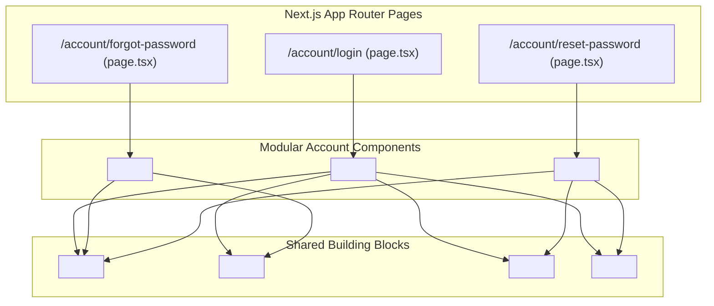
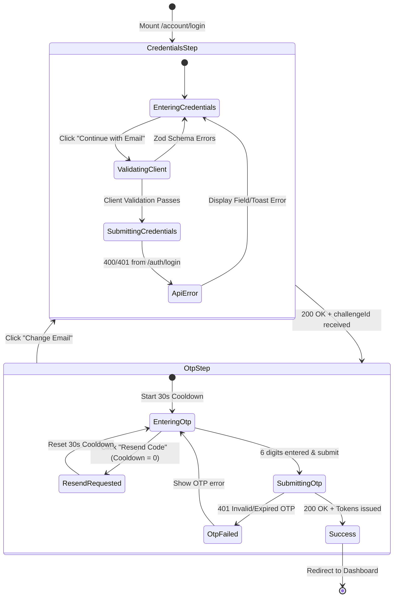
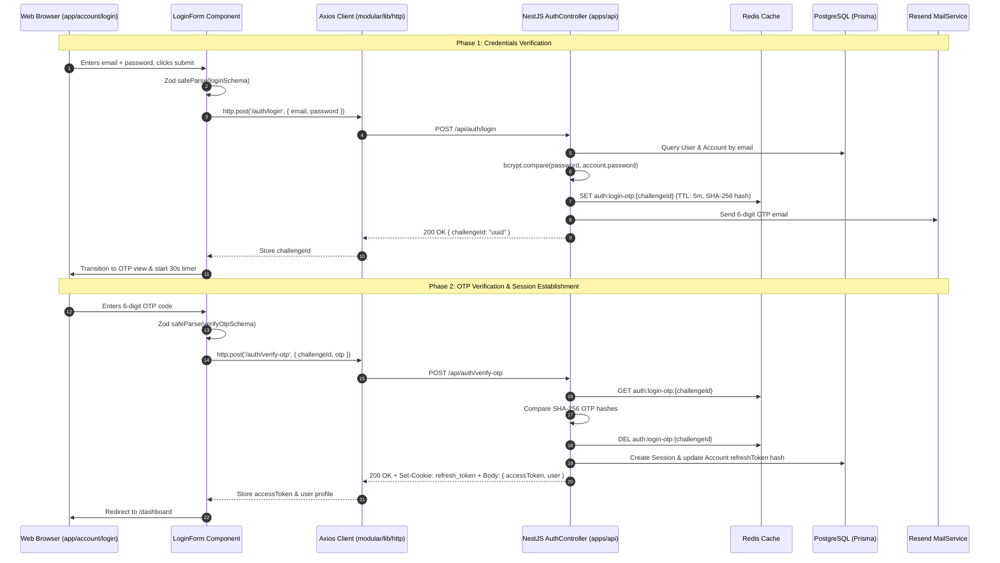

# Account Modular Architecture & Component Integration Guide

This document explains the software architecture, component composition, state management, validation workflows, and App Router route connections for **`apps/web/modular/account`**.

---

## 1. Modular Directory Structure

```text
apps/web/
├── app/
│   └── account/                         # Thin Next.js App Router Page Routes
│       ├── login/page.tsx               # Route: /account/login -> renders <LoginForm />
│       ├── forgot-password/page.tsx     # Route: /account/forgot-password -> renders <ForgotPasswordForm />
│       └── reset-password/page.tsx      # Route: /account/reset-password -> renders <ResetPasswordForm />
└── modular/
    └── account/                         # Self-contained, modular account feature package
        ├── components/                  # UI Presentation & Form state containers
        │   ├── AuthLayoutWrapper.tsx    # Responsive centered card layout with branding & back navigation
        │   ├── AuthFormField.tsx        # Floating/labeled text input with inline error feedback
        │   ├── PasswordField.tsx        # Password input with secure visibility toggle (eye icon)
        │   ├── OtpInputField.tsx        # 6-digit auto-advancing verification code boxes
        │   ├── OtpVerificationForm.tsx  # Dedicated OTP step container with resend countdown timer
        │   ├── LoginForm.tsx            # Full 2-Step interactive login controller
        │   ├── ForgotPasswordForm.tsx   # Self-service recovery form
        │   └── ResetPasswordForm.tsx    # Password reset completion form
        ├── schemas/
        │   └── auth.schema.ts           # Zod validation schemas for forms
        ├── types/
        │   └── index.ts                 # Re-exported shared contracts & inferred Zod types
        ├── utils/
        │   ├── regex.util.ts            # Centralized regex patterns (Email, Password, OTP)
        │   └── auth-error.util.ts       # Utility to extract Zod issue trees into FormErrors<T>
        ├── doc/                         # Technical documentation & API references
        │   ├── README.md                # Documentation navigation hub
        │   ├── account-api-doc.md       # API reference, endpoints, payloads & Axios config
        │   └── account-architecture-doc.md # This architecture guide
        └── index.ts                     # Public API barrel export for the module
```

---

## 2. App Router Integration Mapping

The Next.js App Router routes under `apps/web/app/account` act as **Thin Server Components**. They contain minimal presentation logic, handle metadata, resolve asynchronous URL `searchParams`, and delegate all user interaction to modular components:



### Route Implementations:

1. **`app/account/login/page.tsx`**:
   - URL: `/account/login`
   - Sets page metadata: `Log In — Aayeshol`
   - Directly renders `<LoginForm />`

2. **`app/account/forgot-password/page.tsx`**:
   - URL: `/account/forgot-password`
   - Sets page metadata: `Forgot Password — Aayeshol`
   - Directly renders `<ForgotPasswordForm />`

3. **`app/account/reset-password/page.tsx`**:
   - URL: `/account/reset-password?email=...`
   - Sets page metadata: `Reset Password — Aayeshol`
   - Awaits `searchParams` and pre-populates the email field:
     ```tsx
     export default async function ResetPasswordPage({ searchParams }: ResetPasswordPageProps) {
       const resolvedParams = await searchParams;
       return (
         <Suspense fallback={null}>
           <ResetPasswordForm email={resolvedParams?.email} />
         </Suspense>
       );
     }
     ```

---

## 3. Two-Step Authentication State Machine

The login workflow in `<LoginForm />` implements a 2-Step interactive state machine:



### State Variables in `<LoginForm />`:

| State Variable     | Type                        | Purpose                                             |
| ------------------ | --------------------------- | --------------------------------------------------- |
| `step`             | `'credentials' \| 'otp'`    | Controls active card view                           |
| `email`            | `string`                    | User email address preserved across steps           |
| `password`         | `string`                    | User password (cleared or retained)                 |
| `otp`              | `string`                    | 6-digit numeric verification code                   |
| `isLoading`        | `boolean`                   | Loading spinner during Step 1 submission            |
| `isVerifying`      | `boolean`                   | Loading spinner during Step 2 OTP verification      |
| `resendCooldown`   | `number`                    | Countdown in seconds (30s) before resend is allowed |
| `credentialErrors` | `FormErrors<LoginFormData>` | Zod validation errors for email/password            |
| `otpError`         | `string \| undefined`       | Inline error message for invalid OTP input          |

---

## 4. Client-Side Validation Architecture (Zod)

Validation is performed synchronously before any network request using Zod v4 schemas in `apps/web/modular/account/schemas/auth.schema.ts`:

### 1. `loginSchema`

```typescript
export const loginSchema = z.object({
  email: z
    .string()
    .trim()
    .min(1, 'Email is required.')
    .max(255, 'Email address must not exceed 255 characters.')
    .email('Please provide a valid email address.')
    .regex(EMAIL_REGEX, 'Email address must be a valid format (e.g. user@example.com).'),
  password: z
    .string()
    .min(1, 'Password cannot be empty.')
    .max(128, 'Password must not exceed 128 characters.'),
});
```

### 2. `verifyOtpSchema`

```typescript
export const verifyOtpSchema = z.object({
  otp: z
    .string()
    .trim()
    .min(1, 'OTP is required.')
    .length(6, 'OTP must be exactly 6 digits.')
    .regex(OTP_REGEX, 'OTP must contain numbers only.'),
});
```

### 3. `forgotPasswordSchema`

```typescript
export const forgotPasswordSchema = z.object({
  email: z
    .string()
    .trim()
    .min(1, 'Email is required.')
    .max(255, 'Email address must not exceed 255 characters.')
    .email('Please provide a valid email address.')
    .regex(EMAIL_REGEX, 'Email address must be a valid format (e.g. user@example.com).'),
});
```

### 4. `resetPasswordSchema`

Enforces strong password rules and verifies matching passwords:

```typescript
export const resetPasswordSchema = z
  .object({
    otp: z.string().trim().length(6, 'OTP must be exactly 6 digits.').regex(OTP_REGEX),
    newPassword: z
      .string()
      .min(8, 'New password must be at least 8 characters long.')
      .max(128, 'New password must not exceed 128 characters.')
      .regex(
        STRONG_PASSWORD_REGEX,
        'Password must contain at least 1 uppercase letter, 1 lowercase letter, 1 number, and 1 special character.',
      ),
    confirmPassword: z.string().min(1, 'Please confirm your new password.'),
  })
  .refine((data) => data.newPassword === data.confirmPassword, {
    message: 'Passwords do not match.',
    path: ['confirmPassword'],
  });
```

---

## 5. End-to-End Backend Data Flow (`apps/api/src/auth`)



---

## 6. Component Extension Guidelines

### Connecting Custom Mutation Hooks

Each form component exposes optional async callbacks allowing caller pages or TanStack Query hooks to intercept submissions:

```tsx
<LoginForm
  initialEmail="user@example.com"
  onSubmitCredentials={async ({ email, password }) => {
    const res = await http.post<LoginChallengeResponse>('/auth/login', { email, password });
    setChallengeId(res.data.challengeId);
  }}
  onSubmitOtp={async ({ otp }) => {
    const res = await http.post<TokenPairResponse>('/auth/verify-otp', { challengeId, otp });
    router.push('/dashboard');
  }}
/>
```

### Accessibility & UX Best Practices

1. **Focus Trap & Keyboard Navigation**: `<OtpInputField />` automatically focuses the next input on numeric keystrokes and moves to the previous box on Backspace.
2. **Accessible Labels**: Form fields utilize distinct `<label>` elements connected via `htmlFor` and announce errors with `role="alert"`.
3. **Password Obfuscation**: The `<PasswordField />` component allows users to securely toggle plain text visibility without losing focus.

---

## 7. Zustand Production-Grade Store Architecture

The account module includes a dedicated Zustand authentication store (`apps/web/modular/account/store/auth.store.ts`) configured with strict security boundaries, DevTools debugging, and non-reactive static getters.

```mermaid
graph TD
    subgraph UI Layer
        C["React Components (<LoginForm />, Navbar, Dashboard)"]
    end

    subgraph Zustand Store: useAuthStore
        S["State: { user, accessToken, isLoggedIn, isSessionExpired }"]
        A["Actions: { setAuth, setAccessToken, setUser, clearAuth }"]
        G["Static Getters: getAuthToken(), isAuthenticated()"]
    end

    subgraph Network Layer
        AxiosReq["Axios Request Interceptor"]
        AxiosRes["Axios Response Interceptor"]
    end

    subgraph Server
        API["Backend API: /auth/*"]
    end

    C -->|subscribes to| S
    C -->|calls| A
    G -->|reads state directly without React hook| S
    AxiosReq -->|injects Authorization: Bearer <token>| G
    AxiosReq -->|HTTP Request| API
    API -->|HTTP 401 Unauthorized| AxiosRes
    AxiosRes -->|calls setSessionExpired(true)| A
```

### Store Structure & Interfaces

```typescript
export interface AuthState {
  user: SafeUser | null;
  isLoggedIn: boolean;
  accessToken: string | null; // Stored in-memory only (OWASP compliant)
  isSessionExpired: boolean;
  isLoading: boolean;
}

export interface AuthActions {
  setAuth: (payload: { user: SafeUser; accessToken: string }) => void;
  setAccessToken: (accessToken: string | null) => void;
  setUser: (user: SafeUser | null) => void;
  setIsLoggedIn: (isLoggedIn: boolean) => void;
  setSessionExpired: (isExpired: boolean) => void;
  setIsLoading: (isLoading: boolean) => void;
  clearAuth: () => void;
  logout: () => void;
}
```

### Production Security Best Practices Implemented:

1. **In-Memory JWT Access Token**:
   - `accessToken` is **never stored in `localStorage` or `sessionStorage`**, preventing XSS token exfiltration.
   - Kept in JS memory with an 8-minute lifespan matching the backend JWT expiry.
2. **HTTP-Only Refresh Token Cookie**:
   - Long-lived session persistence (7h) is handled solely by the browser via HTTP-only cookie.
   - When the access token expires, a background call to `/auth/refresh` silently issues a fresh access token without user friction.
3. **Automatic Interceptor Injection**:
   - Outgoing Axios requests automatically read `getAuthToken()` and inject `Authorization: Bearer <token>`.
4. **401 Session Expiration Hook**:
   - When any authenticated endpoint returns `401 Unauthorized`, `setSessionExpired(true)` is immediately dispatched, notifying the UI to prompt for re-authentication or redirect to `/account/login`.

---

## 8. TanStack Query Hooks & Form Synchronization

All asynchronous network mutations and queries in the account module are orchestrated via dedicated TanStack Query v5 hooks located in `apps/web/modular/account/hooks/`:

| Hook                          | Type     | Purpose                                                | Cache & Store Effects                                                                                               |
| ----------------------------- | -------- | ------------------------------------------------------ | ------------------------------------------------------------------------------------------------------------------- |
| `useLoginMutation()`          | Mutation | Step 1: Validates credentials, issues 5m OTP challenge | None (returns `challengeId` for Step 2)                                                                             |
| `useVerifyLoginOtpMutation()` | Mutation | Step 2: Validates OTP code, establishes session        | Updates `useAuthStore.setAuth({ user, accessToken })`<br>Hydrates `queryClient.setQueryData(authKeys.user(), user)` |
| `useForgotPasswordMutation()` | Mutation | Requests 6-digit recovery code                         | None (returns `challengeId` for password reset)                                                                     |
| `useResetPasswordMutation()`  | Mutation | Updates password with OTP & challenge ID               | None (on success, user logs in with new password)                                                                   |
| `useCurrentUserQuery()`       | Query    | Fetches profile from `/auth/me`                        | Synchronizes user profile to Zustand (`setUser`)<br>Stale time: 5 minutes                                           |
| `useLogoutMutation()`         | Mutation | Logs out active session                                | Resets Zustand (`clearAuth()`)<br>Wipes entire cache (`queryClient.clear()`)                                        |

### Cross-User Cache Leak Prevention

When a user logs out via `useLogoutMutation()`, two atomic actions are executed upon mutation settlement:

1. **`clearAuth()`**: Wipes user profile, nullifies in-memory JWT `accessToken`, and resets session booleans in Zustand.
2. **`queryClient.clear()`**: Purges the entire TanStack Query in-memory cache, ensuring no previous user posts, drafts, social tokens, or drive file metadata remain in memory for subsequent sessions.
